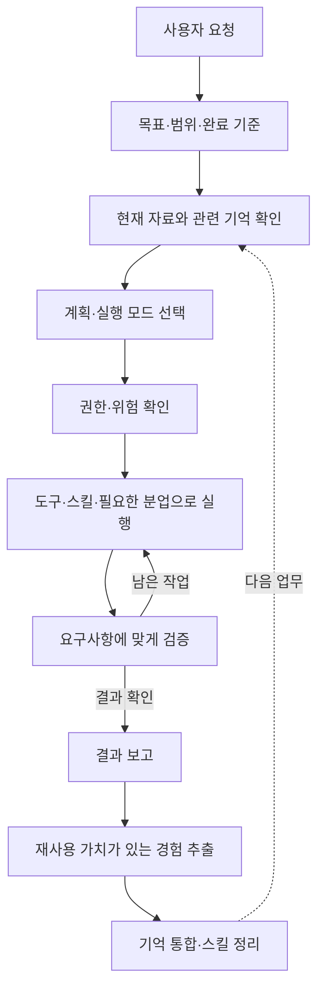

# Codex Astra 공개 지침 — 분할 상세 정리

2026-09-10 기준, 특정 공개 문서를 대상으로 한 프로세스 분석 자료입니다.

요청하신 지침 내용을 5개 영역의 20개 문서로 분할했습니다. 각 문서에는 적용 상황, 실제 규칙, 처리 흐름, 예외·대체 템플릿과의 관계, 설명용 사례, 재사용 관점과 원문 근거를 담았습니다.

[전체 내용을 한 번에 읽기](20260910_전체_상세정리.md) · [원문과 해설의 대응·차이](20260910_90_원문대응과_템플릿관계.md) · [출처와 작성 범위](20260910_99_출처와_작성범위.md)

## 업무 기본 원칙

- [01. 역할과 목표](01_principles/20260910_01_role_and_goal.md) — 공통 업무 원칙
- [02. 자율성과 확인·승인](01_principles/20260910_02_autonomy_and_confirmation.md) — 공통 원칙과 권한 판단
- [03. 소통과 진행·결과 보고](01_principles/20260910_03_communication_and_reporting.md) — 공통 소통 원칙과 출력 형식
- [04. 실행과 검증](01_principles/20260910_04_execution_and_verification.md) — 공통 실행 원칙과 개발 도구 규약

## 업무 실행 체계

- [05. Default와 Plan 실행 모드](02_execution/20260910_05_execution_modes.md) — 상황별 대체 템플릿
- [06. 장기 작업·후속 확인·목표와 예산](02_execution/20260910_06_persistent_work_and_goals.md) — 지속 실행과 목표 관리 템플릿
- [07. 에이전트 역할·위임·협업](02_execution/20260910_07_multi_agent_work.md) — 역할별 지침과 위임 모드
- [08. 스킬·커넥터·플러그인 활용](02_execution/20260910_08_skills_connectors_plugins.md) — 외부 지식과 기능의 선택·로딩

## 안전과 권한

- [09. 샌드박스와 접근 범위](03_permissions/20260910_09_sandbox_and_access.md) — 실행 환경이 제공하는 권한 설정
- [10. 실행 승인과 추가 권한](03_permissions/20260910_10_approval_policies.md) — 실행 시 선택되는 승인 정책
- [11. Guardian 위험·권한 심사](03_permissions/20260910_11_guardian_review.md) — 작업 수행자와 다른 심사 역할
- [12. 브라우저·컴퓨터 조작의 확인 단계](03_permissions/20260910_12_computer_browser_confirmation.md) — 화면 조작에 특화된 정책

## 기억과 업무 연속성

- [13. 기억 조회와 근거 확인](04_memory/20260910_13_memory_retrieval.md) — 기존 지식을 현재 업무에 불러오는 절차
- [14. 실행 경험에서 노하우 추출](04_memory/20260910_14_experience_extraction.md) — 기억 작성 1단계
- [15. 기억 통합과 스킬화](04_memory/20260910_15_consolidation_and_skills.md) — 기억 작성 2단계
- [16. 문맥 압축·중단·환경 변경과 인계](04_memory/20260910_16_context_and_continuity.md) — 현재 작업 상태를 보존하는 전환 템플릿

## 제품·도구별 지침

- [17. 도구 호출·검색·이미지의 실행 규약](05_product/20260910_17_tool_execution_protocols.md) — 실행 도구에 특화된 인터페이스 안내
- [18. 데스크톱 산출물·작업 관리·자동화](05_product/20260910_18_desktop_and_automation.md) — Codex 데스크톱 기능별 지침
- [19. 코드 리뷰의 판정·우선순위·출력](05_product/20260910_19_code_review.md) — 검토자 역할 전용 지침
- [20. 실시간 대화와 실행 담당의 연결](05_product/20260910_20_realtime_conversation.md) — 음성·대화 표면과 실행 역할의 계약

## 연결도 — 이해를 위한 재구성

아래 그림은 흩어진 주제를 연결한 해설이며, 원문이 정의한 단일 실행 순서를 복제한 그림은 아닙니다.

## 읽는 방법

업무 운영 원칙을 먼저 보려면 01–08번을 읽으면 됩니다. 경험을 노하우와 스킬로 축적하는 과정은 13–15번에서 이어집니다. 09–12번과 17–20번은 실행 환경이나 담당 역할에 따라 적용 여부를 구분해야 합니다.

## Living Docs 반영 후보

현재는 분석 자료로 보존합니다. 공용 지침이나 실제 스킬에 반영한 항목은 없습니다. 적용 여부를 검토할 경우 목표·완료 기준, 모드 구분, 노하우 추출·검증·스킬화 절차가 후보입니다. 구체적인 권한 정책과 도구 호출 형식은 해당 환경의 현재 계약을 확인한 뒤 판단해야 합니다.
